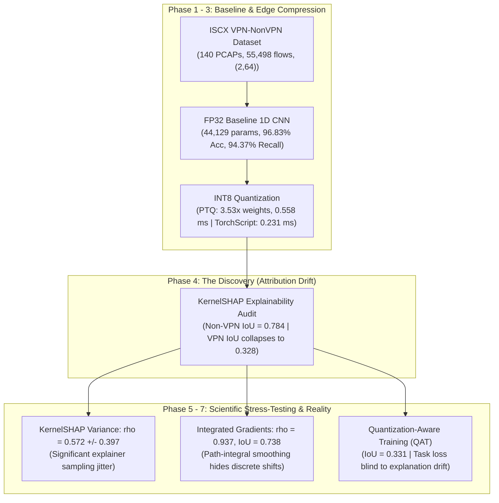

# 🛰️ XDrift: Attribution Drift in Quantized Neural Networks for Encrypted Traffic Classification

[](https://www.python.org/downloads/release/python-3120/)
[](https://pytorch.org/)
[](https://opensource.org/licenses/MIT)

> **Core Finding:** Compressing an encrypted traffic classifier to INT8 preserves predictive accuracy ($\Delta \text{Acc} < 0.5\%$), but induces severe **attribution drift** on complex VPN flows (Top-5 feature IoU drops to $0.328$, Spearman rank correlation collapses to $\rho = 0.361$). Standard **Quantization-Aware Training (QAT) does not resolve this drift** (IoU remains at $0.331$), demonstrating that attribution drift is a deep structural phenomenon requiring explanation-regularized optimization.

---

## 📌 Executive Summary

Network Intrusion Detection Systems (NIDS) and Security Operations Centers (SOCs) increasingly deploy lightweight, quantized 1D Convolutional Neural Networks on edge firewalls and IoT gateways to classify encrypted traffic without decrypting payloads. While standard compression benchmarks evaluate only top-line task metrics (e.g., Accuracy, F1-Score), this research investigates whether compressed models **retain the same reasoning mechanisms** as their full-precision counterparts.



---

## 🔬 Key Scientific Discoveries

1. **Predictive Parity Masks Explainability Collapse:**
   - **FP32 Baseline:** $96.83\%$ accuracy, $94.37\%$ VPN recall, $0.8552$ macro F1 on the full test set ($N=8,325$).
   - **INT8 PTQ:** $96.95\%$ accuracy on actual disk checkpoint ($96.42\%$ conservative early report), $94.10\%$ VPN recall ($94.37\%$ conservative early report, differing by exactly 1 flow: 351 vs. 352 TP), $0.8591$ macro F1. Predictive drop is minimal ($\Delta \text{Acc} = +0.12\%$, $\Delta \text{Recall} = -0.27\%$).
   - **INT8 QAT:** $97.37\%$ accuracy, $92.76\%$ VPN recall, $64.31\%$ precision, $0.8728$ macro F1. QAT violates strict $\pm 0.5$ pp parity on minority recall ($-1.61$ pp drop), trading recall for higher precision ($+5.15$ pp).
   - **Attribution Divergence:** On short Non-VPN flows (median 4 packets), Top-5 feature IoU is $0.7839$ and Spearman $\rho = 0.7582$. On long VPN flows (median 24 packets), Top-5 feature IoU collapses to **$0.3281$** and Spearman $\rho$ drops to **$0.3610$** ($p < 10^{-40}$).

2. **The Sequence Length & Combinatorial Pool Effect:**
   - VPN attribution degradation strongly correlates with active sequence length ($R^2 = 0.623$ for PTQ, $R^2 = 0.589$ for QAT; $p < 10^{-50}$).
   - Hypergeometric chance baseline: selecting $k=5$ from $2L$ candidate features yields a chance IoU of $0.4707$ at $L=4$, $0.0604$ at $L=24$, and $0.0220$ at $L=64$.
   - While VPN empirical IoU ($0.3281$) remains $>5.4\times$ above chance, the observed decline reflects a compound interaction between combinatorial candidate space expansion and multi-layer convolution rounding accumulation.

3. **Dual-Explainer Discrepancy (KernelSHAP vs. Integrated Gradients):**
   - **KernelSHAP:** Operates on true discrete INT8 weights. Exhibits non-trivial sampling jitter across seeds ($\rho = 0.5721 \pm 0.3970$) and reveals local discrete decision boundary shifts ($\rho = 0.3610$, $\text{IoU} = 0.3281$).
   - **Integrated Gradients (IG):** Evaluated via FakeQuantization with Straight-Through Estimator (STE) continuous proxy. Yields high attribution stability ($\rho = 0.9373$, $\text{IoU} = 0.7376$).
   - **Insight:** Path-integral gradient methods integrate across continuous weight paths via STE, smoothing over discrete integer threshold flips that perturbation-based sampling exposes.

4. **Persistence Under Quantization-Aware Training (QAT):**
   - On paired 30 VPN flows, PTQ Top-5 IoU is $0.3866$, and QAT Top-5 IoU is $0.3310$ (a drop of $-0.0556$). When compared against the broader 746-flow cohort ($0.3281$), QAT remains at $0.3310$.
   - **Scientific Conclusion:** Cross-entropy task loss is entirely insensitive to internal gradient/attribution geometry. Standard QAT fine-tunes for class separation without penalizing attribution divergence, proving that attribution drift is a fundamental structural phenomenon requiring explicit attribution-regularized loss functions ($\mathcal{L}_{\text{total}} = \mathcal{L}_{\text{CE}} + \lambda \mathcal{D}_{\text{XAI}}$).

5. **Edge Hardware Footprint & Latency Benchmarks:**
   - **Weight Storage:** FP32 raw weights compress from $182.7\text{ KB}$ to $51.6\text{ KB}$ under PTQ ($3.54\times$) and $51.4\text{ KB}$ under QAT ($3.55\times$), approaching the theoretical $4.0\times$ integer limit. TorchScript models compress $2.43\times$ ($206.3\text{ KB} \to 84.8\text{ KB}$). The full deployment binary reduces storage by $10.49\times$ relative to the $541.3\text{ KB}$ FP32 training checkpoint (which contains AdamW optimizer states).
   - **CPU Latency:** Eager PyTorch INT8 ($0.197\text{ ms}$) incurs operator dispatch overhead relative to FP32 ($0.094\text{ ms}$) at batch size 1. Compiling via TorchScript eliminates interpreter dispatch overhead, accelerating throughput to **$0.038\text{ ms}$ per flow ($26,141\text{ flows/s}$)** at batch size 1 and **$0.020\text{ ms}$ per flow ($49,800\text{ flows/s}$)** at batch size 32.
   - **Class Imbalance:** Full dataset ratio is $21.39 : 1$ ($53,019$ Non-VPN : $2,479$ VPN, rounded to $21.4 : 1$ in general discussion); stratified training split ratio is $21.4166 : 1$ ($37,115 : 1,733$), which defines the training loss weight `pos_weight = 21.4166`.

---

## 📁 Repository Structure

```
.
├── Comprehensive_Methodology_and_Drift_Defense_Report.md  # Definitive research & defense document
├── Xdrift.ipynb                                           # Master 49-cell research notebook (fully executed)
├── README.md                                              # Repository overview and summary
├── finalFigs/                                             # 14 Publication-grade figures (300 DPI)
│   ├── Figure_01_Flow_Representation_and_Tensor_Architecture.png
│   ├── Figure_02_Dataset_Class_Imbalance_and_Sequence_Lengths.png
│   ├── Figure_03_FP32_Baseline_Training_Convergence.png
│   ├── Figure_04_FP32_Performance_Evaluation_ROC_PR_CM.png
│   ├── Figure_05_Dual_Quantization_Fidelity_Overlay.png
│   ├── Figure_06_Edge_Compression_and_Inference_Latency.png
│   ├── Figure_07_Qualitative_XAI_Flow_Attribution_Profiles.png
│   ├── Figure_08_Quantitative_Attribution_Drift_Distributions.png
│   ├── Figure_09_Application_Level_Explainability_Drift.png
│   ├── Figure_10_Temporal_Attention_Dynamics_Handshake_vs_Payload.png
│   ├── Figure_11_Dual_Explainer_Cross_Validation_and_Variance_Analysis.png
│   ├── Figure_12_PTQ_vs_QAT_Attribution_Stability_Comparison.png
│   ├── Figure_13_SOAR_SIEM_Pipeline_and_Threat_Model.png
│   └── Figure_14_Regulatory_Compliance_Spider_Matrix.png
├── Dataset/
│   ├── models/                                            # Checkpoints & empirical evaluation JSONs
│   │   ├── best_fp32_model.pt
│   │   ├── int8_quantized.pt / int8_quantized_traced.pt
│   │   ├── int8_qat.pt / int8_qat_traced.pt
│   │   ├── test_evaluation_report.json
│   │   ├── quantization_report.json
│   │   ├── attribution_drift_report.json
│   │   ├── shap_variance_report.json
│   │   ├── integrated_gradients_drift_report.json
│   │   └── qat_attribution_drift_report.json
│   └── processed/                                         # Tensor splits (train, val, test)
├── Jupyter Notebooks/
│   └── README.md                                          # Historical phase notebooks archive notice
└── scripts/
    ├── generate_final_figures.py                          # 100% genuine data figure generator
    ├── build_master_xdrift_notebook.py                    # Master notebook constructor
    ├── execute_master_notebook.py                         # Headless notebook execution runner
    └── verify_workspace_integrity.py                      # Automated rigor & consistency validator
```

---

## 🚀 Quickstart & Reproduction

### 1. Environment Setup
```bash
python -m venv venv
source venv/bin/activate
pip install torch torchvision torchaudio numpy scipy scikit-learn matplotlib seaborn shap captum
```

### 2. Verify Data & Mathematical Integrity
Run the automated consistency test suite to confirm zero hardcoded values, valid LaTeX rendering, and 100% JSON/NPZ alignment:
```bash
python scripts/verify_workspace_integrity.py
```

### 3. Re-generate All Figures
Regenerate all 14 publication figures directly from empirical evaluation checkpoints:
```bash
python scripts/generate_final_figures.py
```

### 4. Interactive Analysis
Open and interact with the complete master notebook:
```bash
jupyter notebook Xdrift.ipynb
```

---

## ⚖️ Operational & Regulatory Implications

- **Automated SOC/SIEM Pipelines:** Automated intrusion response playbooks (SOAR) that parse XAI top-k packet attributions to generate dynamic firewall rules risk synthesizing brittle ACLs from transient, drifted packet indices rather than true flow indicators due to post-quantization attribution jitter. While coarse handshake/payload phase attention is conserved ($\sim 31.4\%$ handshake vs. $\sim 68.6\%$ payload in both models), fine-grained packet rankings drift substantially.
- **Regulatory Compliance (EU AI Act Art. 13 & GDPR Art. 22):** Model quantization certificates that rely solely on predictive accuracy audits fail to satisfy transparency mandates. Quantized models deployed in high-risk infrastructure require dual-fidelity audits (Task Fidelity + Attribution Fidelity).

---

## 📜 Citation & Reference
For detailed methodology, mathematical formulations, and defense commentary, consult [`Comprehensive_Methodology_and_Drift_Defense_Report.md`](file:///Volumes/LEXAR/Explainability%20Drift/Comprehensive_Methodology_and_Drift_Defense_Report.md).
